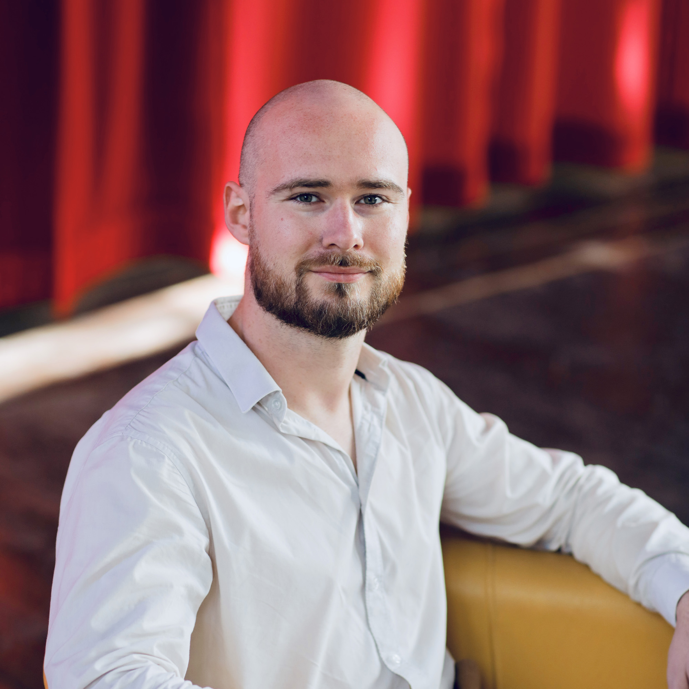

{:class="people-profile-image"}

# Hello there!

Hello, I am a happy postdoc at [Chalmers](https://www.chalmers.se/en/) (Gothenburg, Sweden), under the supervision of [Fredrik Johansson](https://www.fredjo.com/) since 2026. Prior to that, I finished a first postdoc at [Linköping University](https://www.liu.se) under the supervision of [Fredrik Lindsten](https://lindsten.netlify.app/). In 2024, I graduated from a cotutelle PhD both in computer science at [Université Côte d'Azur](https://univ-cotedazur.eu/) (Nice, France) with [Frédéric Precioso](https://webusers.i3s.unice.fr/~precioso/), [Pierre-Alexandre Mattei](https://pamattei.github.io/), and in molecular medicine from [Université Laval](https://www.ulaval.ca/en) (Quebec, Canada) with [Arnaud Droit](https://www.crchudequebec.ulaval.ca/en/research/researchers/arnaud-droit/). And yes, I always have a supervisor named Fred*.

# Research

My main areas of interest encompass unsupervised learning, specifically discriminative models, and their application with or without constraints for instance in health or material science. I am progressively shifting towards contrastive learning and trees. I try to stir as much as possible  my applications towards tabular data. You may find up-to-date ideas and projects on my [webpage](https://oshillou.github.io).